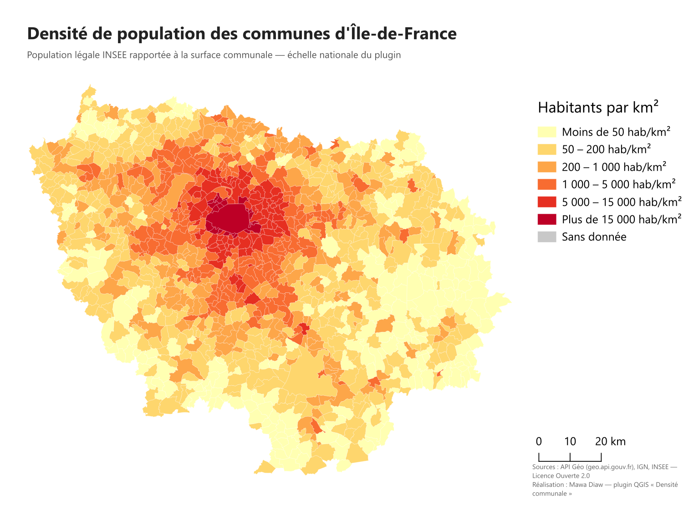
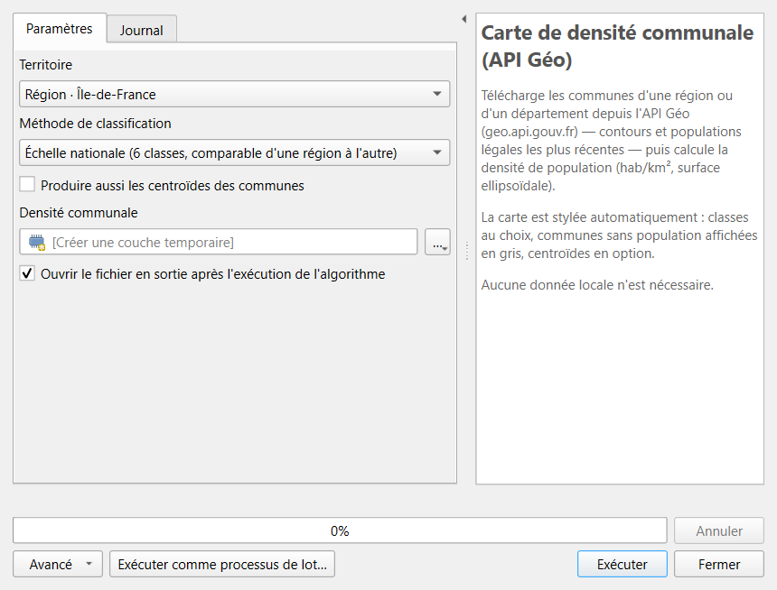
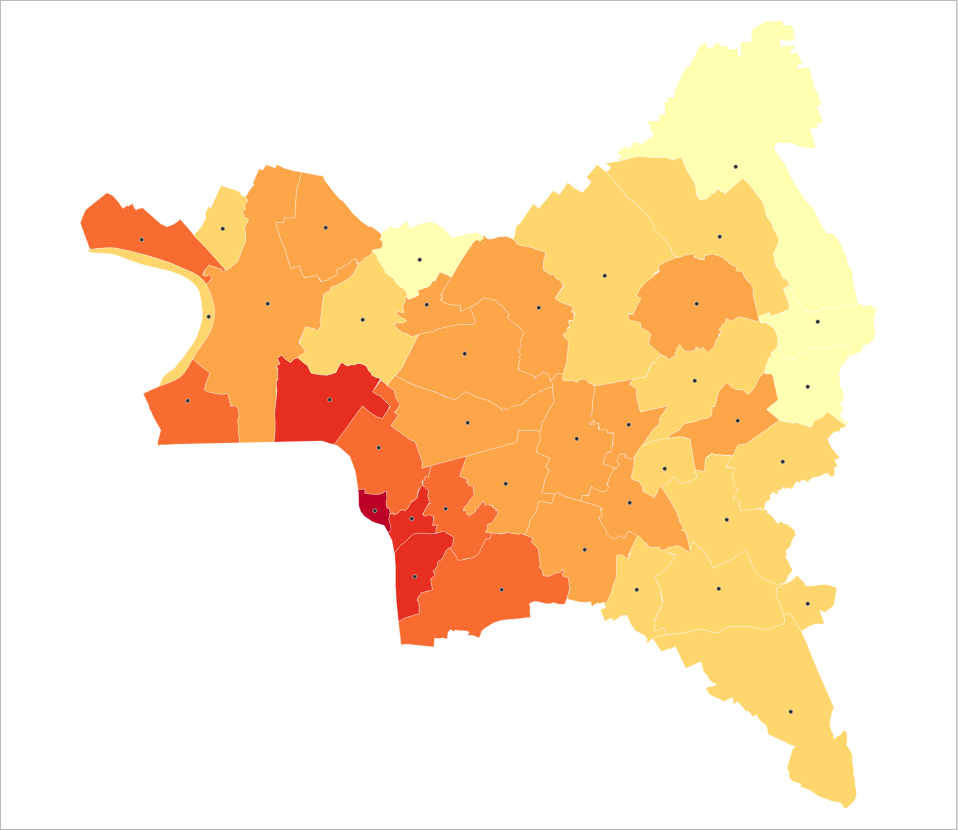

<div align="center">

# Densité communale

**Plugin QGIS — la carte de densité de population des communes françaises en un clic, à partir des données officielles.**




</div>

Choisissez une région ou un département dans une liste déroulante : le plugin télécharge les contours des communes et leurs populations légales sur l'[API Géo](https://geo.api.gouv.fr) de l'État, calcule la densité et affiche une carte prête à l'emploi. **Aucune donnée à télécharger ni à préparer.**

> **Deux versions de ce projet existent.**
> - **Version 2 (ce dépôt)** — plugin QGIS installable qui télécharge lui-même les données officielles (API Géo).
> - **Version 1 — [densite-communale-v1](https://github.com/mawa399/densite-communale-v1)** — script de traitement qui travaille sur vos propres couches de communes et de population : c'est la version d'origine, issue de l'exercice.

## Sommaire

- [Fonctionnalités](#fonctionnalités)
- [Installation](#installation)
- [Utilisation](#utilisation)
- [Classifications](#classifications)
- [Données produites](#données-produites)
- [Comment ça marche](#comment-ça-marche)
- [Structure du dépôt](#structure-du-dépôt)
- [Limites connues](#limites-connues)
- [Sources des données](#sources-des-données)
- [Origine du projet](#origine-du-projet)
- [Auteur et licence](#auteur-et-licence)

## Fonctionnalités

- **Tout le territoire** : 18 régions et 101 départements, outre-mer compris, dans une liste déroulante.
- **Données toujours à jour** : découpage communal en vigueur et populations légales INSEE, récupérés en direct.
- **Densité fiable** : surface mesurée sur l'ellipsoïde (indépendante de la projection du projet), résultat en Lambert-93 pour la métropole.
- **Trois classifications** : échelle nationale comparable d'un territoire à l'autre, seuils naturels de Jenks ou quantiles.
- **Carte stylée automatiquement** : dégradé jaune → rouge, communes sans population en gris (aucun trou dans la carte), zoom sur le territoire.
- **Centroïdes en option** : un point par commune, toujours situé à l'intérieur de celle-ci.
- **Intégré à QGIS** : bouton dans la barre d'outils, menu *Extensions*, boîte à outils de traitements, modeleur graphique, traitement par lot et Python.

## Installation

### Depuis un ZIP

1. Téléchargez le ZIP de la **[dernière version](https://github.com/mawa399/densite-communale/releases/latest)** (fichier `densite_communale-x.y.z.zip`).
2. Dans QGIS : **Extensions → Installer/Gérer les extensions → Installer depuis un ZIP**, choisissez le fichier, puis **Installer l'extension**.
3. L'icône **Densité communale** apparaît dans la barre d'outils des extensions.

### Depuis les sources

Copiez le dossier [`densite_communale/`](densite_communale) dans le dossier des extensions de votre profil QGIS (*Préférences → Profils utilisateurs → Ouvrir le dossier du profil actif*, puis `python/plugins/`), redémarrez QGIS et activez l'extension dans le gestionnaire.

**Prérequis** : QGIS 3.34 ou plus récent (QGIS 4 compris) et une connexion internet. Aucune bibliothèque Python supplémentaire.

## Utilisation

1. Cliquez sur l'icône **Densité communale** (ou *Extensions → Densité communale → Carte de densité communale…*).
2. Choisissez le **territoire**, la **méthode de classification** et, si besoin, cochez **les centroïdes**.
3. Cliquez sur **Exécuter** : la carte s'affiche et QGIS zoome dessus.



L'outil se trouve aussi dans la boîte à outils de traitements (*Densité communale → Démographie*). Il s'utilise donc dans le modeleur graphique, en traitement par lot ou depuis la console Python :

```python
import processing

processing.runAndLoadResults("densite_communale:densite_communale", {
    "TERRITOIRE": 0,           # index dans la liste : 0 = Région · Île-de-France
    "METHODE": 0,              # 0 = échelle nationale, 1 = Jenks, 2 = quantiles
    "AVEC_CENTROIDES": False,  # True pour ajouter les centroïdes
    "SORTIE": "TEMPORARY_OUTPUT",  # ou un chemin, par exemple "C:/donnees/densite_idf.gpkg"
})
```

<div align="center">



*Seine-Saint-Denis — seuils naturels de Jenks, avec les centroïdes des communes.*

</div>

## Classifications

| Méthode | Principe | Quand l'utiliser |
|---|---|---|
| **Échelle nationale** *(par défaut)* | 6 classes fixes : < 50 · 50–200 · 200–1 000 · 1 000–5 000 · 5 000–15 000 · > 15 000 hab/km² | Comparer plusieurs territoires avec la même légende |
| **Seuils naturels de Jenks** | 6 classes calculées sur les valeurs du territoire | Faire ressortir les contrastes internes d'un territoire |
| **Quantiles** | 6 classes de même nombre de communes | Classer les communes les unes par rapport aux autres |

## Données produites

| Champ | Type | Description |
|---|---|---|
| `code_insee` | texte | Code officiel géographique de la commune |
| `nom` | texte | Nom de la commune |
| `code_dep` | texte | Code du département |
| `population` | entier | Population légale INSEE |
| `surface_km2` | réel | Surface ellipsoïdale en km² |
| `densite` | réel | Densité en habitants par km² (arrondie à 0,1) |

Système de coordonnées : **Lambert-93 (EPSG:2154)** pour la métropole et la Corse, **WGS 84 (EPSG:4326)** pour l'outre-mer.

## Comment ça marche

1. **Téléchargement** — appel à l'API Géo pour le territoire choisi :
   `https://geo.api.gouv.fr/communes?codeRegion=11&fields=nom,code,codeDepartement,population&format=geojson&geometry=contour`
   La requête passe par le gestionnaire réseau de QGIS : le proxy configuré dans QGIS est pris en compte.
2. **Calcul** — pour chaque commune, surface mesurée sur l'ellipsoïde WGS 84, puis densité = population / surface en km².
3. **Sortie** — reprojection, écriture de la couche (temporaire ou fichier), puis nom, style et zoom appliqués au chargement dans le projet.

## Structure du dépôt

```
densite-communale/
├── densite_communale/          Le plugin (dossier à installer dans QGIS)
│   ├── __init__.py             Point d'entrée lu par QGIS
│   ├── plugin.py               Bouton, menu et enregistrement du fournisseur
│   ├── provider.py             Fournisseur Processing (boîte à outils)
│   ├── densite_algorithm.py    L'algorithme : téléchargement, calcul, style
│   ├── metadata.txt            Fiche du plugin (nom, version, auteur…)
│   └── icon.svg                Icône
├── docs/                       Captures utilisées dans ce README
├── .github/workflows/          Création automatique du ZIP à chaque version
├── CHANGELOG.md                Historique des versions
└── LICENSE                     Licence GPL v2
```

## Limites connues

- Une **connexion internet** est nécessaire : les données ne sont pas stockées dans le plugin.
- Les grandes régions (plus de 4 000 communes, comme la Nouvelle-Aquitaine) prennent une dizaine de secondes.
- La densité est calculée à l'échelle de la **commune entière** : une commune très étendue avec un bourg dense peut apparaître peu dense.
- Les couches sont **temporaires** par défaut. Pour les conserver, choisissez un fichier de sortie ou utilisez *Rendre permanent* dans QGIS.

## Sources des données

- Contours et populations : [API Géo](https://geo.api.gouv.fr), service de l'État, à partir des données de l'**IGN** (Admin Express) et de l'**INSEE** (populations légales).
- Ces données sont publiées sous [Licence Ouverte 2.0](https://www.etalab.gouv.fr/licence-ouverte-open-licence/) : pensez à citer la source sur vos cartes.

## Origine du projet

Ce plugin prolonge un exercice de PyQGIS réalisé en Master 2 Géomatique (Université Paris 8) : un outil qui produisait la carte de densité d'une région à partir de shapefiles fournis. Cette version remplace les fichiers locaux par les données ouvertes de l'État, couvre tout le territoire, améliore la cartographie et devient une extension installable.

## Auteur et licence

**Mawa Diaw** — Géomaticien / Développeur SIG · [GitHub](https://github.com/mawa399) · [LinkedIn](https://www.linkedin.com/in/mawa-diaw)

Les suggestions et signalements de bugs sont les bienvenus dans les [Issues](https://github.com/mawa399/densite-communale/issues).

Distribué sous licence **GNU GPL v2 ou ultérieure** — voir [LICENSE](LICENSE).
